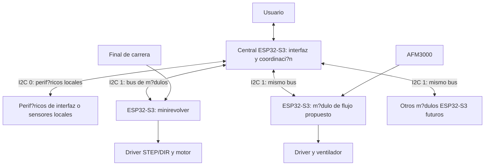

# Modular Air Flow

Sistema modular para generar, medir y dirigir flujo de aire. La propuesta es usar **ESP32-S3 en la central y en todos los m?dulos**, con una central que act?e como **interfaz de usuario y coordinador**, y m?dulos que ejecuten localmente el control de sus actuadores y sensores.

El repositorio contiene tanto las pruebas que ya funcionaron como los primeros ejemplos de comunicaci?n entre m?dulos. Cada carpeta con un `.ino` es un sketch independiente: abrir y cargar ?nicamente el correspondiente a cada placa.

## Arquitectura propuesta

La central ser? el punto desde el que el usuario selecciona acciones, ajusta par?metros y consulta el estado del sistema. La interfaz inicial es el monitor USB serial; una pantalla con controles f?sicos o una interfaz web son opciones futuras, todav?a sin implementar ni seleccionar.

Cada m?dulo tendr? su propio ESP32-S3 y una funci?n concreta. La central enviar? ?rdenes de alto nivel, como una posici?n o un valor de PWM, y consultar? el resultado. Los pulsos del motor, la lectura de sensores y la ejecuci?n de las ?rdenes se resolver?n en el m?dulo correspondiente.

El diagrama representa **la arquitectura objetivo**, no todo el c?digo disponible hoy. El firmware `centralI2C` todav?a lee el AFM3000 y controla el ventilador directamente desde la central. Separar esas funciones en un m?dulo ESP32-S3 de flujo es el siguiente paso de arquitectura; ese firmware a?n no existe.

### Responsabilidades

| Elemento | Funci?n propuesta | Estado actual |
| --- | --- | --- |
| Central ESP32-S3 | Interfaz de usuario, env?o de ?rdenes y presentaci?n de estados | Ejemplo con monitor USB, dos buses I2C y un minirevolver remoto; tambi?n conserva el sensor y PWM locales |
| Minirevolver ESP32-S3 | Movimiento, b?squeda de origen y respuesta con posici?n/estado | Sketch I2C creado; pendiente de prueba en hardware |
| M?dulo de flujo ESP32-S3 | Lectura del AFM3000 y PWM del ventilador, con ?rdenes y respuesta al central | Propuesto; la funci?n conjunta est? probada en el sketch independiente de ESP32-C3 |
| M?dulos adicionales ESP32-S3 | Nuevos actuadores o mediciones, cada uno con su direcci?n | Por definir |

Usar la misma familia de microcontrolador facilita mantener una base com?n de firmware y herramientas. El modelo concreto de placa ESP32-S3, sus conectores y la asignaci?n definitiva de pines a?n deben elegirse. Usar S3 en todos los nodos no exige utilizar sus dos buses en cada m?dulo.

## Comunicaci?n: I2C 0 e I2C 1

| Bus de la central | Papel | Implementaci?n actual |
| --- | --- | --- |
| **I2C 0** | Perif?ricos locales: sensores y, si se elige una interfaz I2C, sus componentes | AFM3000 en `0x40`, c?digo separado en `I2C0Sensores.h` |
| **I2C 1** | Comunicaci?n bidireccional con m?dulos ESP32-S3 | Minirevolver en `0x30`, c?digo separado en `I2C1Modulos.h` |

Varios m?dulos comparten SDA, SCL y GND con direcciones distintas. La central inicia las transacciones: manda una orden y consulta la respuesta. Cada m?dulo informa si est? ocupado, su estado y el resultado de la orden. La posici?n reportada por el minirevolver es un conteo de pasos, no una medida de encoder.

Los buses 0 y 1 son independientes y sus l?neas de se?al no se unen. Los n?meros identifican controladores dentro de cada microcontrolador: el minirevolver puede usar su I2C local 0 como dispositivo conectado al I2C 1 de la central.

La propuesta inicial usa **cables cortos**, I2C a **100 kHz** y se?ales de **3,3 V** entre microcontroladores. Un m?dulo puede estar fuera de la caja, pero la distancia, capacitancia y ruido del cableado deben comprobarse. Para enlaces de metros o mayor exposici?n al ruido de motores, considerar RS-485 o CAN con sus transceptores; ambos permiten una red de varios m?dulos. Esas alternativas no est?n implementadas.

El AFM3000 conserva su alimentaci?n de 5 V y el conversor bidireccional I2C de 3,3 V a 5 V. Los detalles de conectores, pull-ups, mensajes y direcciones est?n en la [propuesta de comunicaci?n](sistemasI2C/README.md).

## Organizaci?n del repositorio

### Nueva arquitectura ESP32-S3

| Carpeta | Contenido | Estado |
| --- | --- | --- |
| [centralI2C](centralI2C/README.md) | Central, USB serial, buses I2C 0/1 separados y ?rdenes remotas | Creado, pendiente de compilaci?n y prueba por el usuario |
| [minirevolveri2c](minirevolveri2c/README.md) | M?dulo de movimiento I2C, direcci?n `0x30` | Creado; seleccionar ESP32-S3 para la arquitectura propuesta |
| [sistemasI2C](sistemasI2C/README.md) | Dise?o del enlace, cableado y protocolo versi?n 1 | Documentaci?n de la primera integraci?n |

El sketch del minirevolver conserva ramas de compatibilidad para ESP32 cl?sico y C3; **la plataforma elegida para los nuevos m?dulos es ESP32-S3**. Esas ramas no cambian la propuesta de hardware.

### Pruebas y referencias anteriores

| Carpeta | Contenido | Resultado o alcance |
| --- | --- | --- |
| [ventiladorFlujo](ventiladorFlujo/README.md) | PWM manual y lectura del AFM3000 en ESP32-C3 | Funcionamiento confirmado por el usuario |
| [airSensor](airSensor/README.md) | Lectura aislada del sensor y manual PDF | Lecturas confirmadas por el usuario |
| [pruebaPWM](pruebaPWM/README.md) | `analogWrite()` en GPIO9, ajustable por USB serial | Funcionamiento confirmado en otro hardware ESP32-C3 |
| [ventilador](ventilador/README.md) | Rampas autom?ticas del puente en ambos sentidos | El sentido izquierdo, LPWM, se reutiliz? en el montaje de flujo |
| [minirevolver](minirevolver/README.md) | Control original del motor por serial | Pines 5/23/27 y limitaciones de comandos documentadas; no trasladar directamente al S3 |

Los sketches anteriores se conservan como referencias funcionales. La decisi?n de usar S3 en el nuevo sistema no significa que esas pruebas ya se hayan migrado o validado en S3.

## Primera integraci?n disponible

El punto de entrada es [centralI2C.ino](centralI2C/centralI2C.ino), con un ESP32-S3 central y otro ESP32-S3 ejecutando [minirevolveri2c.ino](minirevolveri2c/minirevolveri2c.ino).

| Conexi?n | Central S3 | Minirevolver S3 |
| --- | --- | --- |
| I2C de m?dulos SDA | GPIO10 | GPIO10 |
| I2C de m?dulos SCL | GPIO11 | GPIO11 |
| Referencia el?ctrica | GND | GND |
| Sensor AFM3000 local: SDA/SCL | GPIO8 / GPIO9, mediante conversor de nivel | No conectado en este m?dulo |
| Ventilador local: R_EN/L_EN/RPWM/LPWM | GPIO4 / GPIO5 / GPIO6 / GPIO7 | No conectado en este m?dulo |
| Motor: STEP/DIR/HOME | No conectado en la central | GPIO5 / GPIO6 / GPIO7 |

Son asignaciones propuestas para placas que expongan esos pines. **El cableado cambia respecto al C3 probado:** GPIO9 en la central S3 es SCL del sensor; el PWM del ventilador est? en GPIO7. Verificar tambi?n el tipo de contacto del final de carrera y el recorrido mec?nico antes de probar el movimiento.

La interfaz actual usa USB nativo, **USB CDC On Boot activado**, monitor a **115200** y terminaci?n **Nueva l?nea**. Los ejemplos se prepararon para Arduino-ESP32 **2.0.17**. El m?dulo de movimiento requiere `ESP_FlexyStepper`.

| Comando en la central | Acci?n |
| --- | --- |
| `PWM 128` | Ajustar el PWM del ventilador local |
| `STOP` | Apagar solamente el ventilador |
| `REV HOME` | Buscar el origen del minirevolver |
| `REV POS 1` | Solicitar la posici?n predefinida 1 |
| `REV MOVE 160` | Solicitar posici?n absoluta de 160 pasos |
| `REV STOP` | Solicitar parada del minirevolver |
| `ESTADO` | Mostrar flujo, PWM y estado del m?dulo |

El minirevolver exige completar homing antes de aceptar posiciones. Los l?mites de recorrido del ejemplo son provisionales. Consultar los README de ambas placas para los dem?s comandos y el significado de las confirmaciones.

## Resultados del montaje de flujo

Las pruebas anteriores, comunicadas por el usuario, establecieron lo siguiente:

| Observaci?n | Interpretaci?n |
| --- | --- |
| Aproximadamente **2 a 35 slm** con el ventilador actual | Rango observado en ese montaje; no es el rango nominal del sensor |
| Puede no arrancar con **PWM 160**, pero mantenerse a ese valor una vez girando | El umbral de arranque es distinto del m?nimo de marcha |
| Se detiene cerca de **PWM 60** al reducir la orden | Umbral aproximado observado, no aplicado como l?mite por software |
| Se cambi? a un ventilador que responde al PWM | No se puede asumir la misma respuesta para cualquier ventilador brushless |
| Referencia en **1,8 slpm** y AFM3000 entre **1,90 y 2,30 slm** en una comparaci?n | Diferencia pendiente de estudiar; no se aplic? correcci?n de calibraci?n |

**slm** expresa litros est?ndar por minuto; el manual del AFM3000 usa **20 ?C y 1013 mbar**. Para comparar con otro equipo hay que confirmar sus condiciones est?ndar y la estabilidad de ambas lecturas. El AFM3000 compensa internamente la temperatura, pero el manual disponible no documenta un comando para leerla.

Se mantiene el control manual de PWM y la lectura del caudal. No est?n implementados el control autom?tico de caudal, un impulso de arranque, un m?nimo autom?tico de marcha ni una correcci?n de calibraci?n. Las propuestas de PWM 255 durante 300 ms y m?nimo 70 quedan como opciones no validadas, no como requisitos del sistema.

## Pr?ximos pasos de la propuesta

1. Elegir una placa ESP32-S3 com?n y confirmar pines, conectores y alimentaci?n de los m?dulos.
2. Probar central y minirevolver por I2C, incluida la recepci?n de estados durante un movimiento.
3. Separar ventilador y AFM3000 en un m?dulo de flujo ESP32-S3 con su protocolo de ?rdenes y respuesta.
4. Definir la interfaz de usuario de la central y construirla sobre las funciones de comunicaci?n ya verificadas.
5. Evaluar RS-485 o CAN si el cableado externo supera lo adecuado para el bus I2C probado.

## Reglas de trabajo

Por indicaci?n del usuario, el asistente **no debe compilar ni cargar firmware**. Las verificaciones realizadas por el asistente son revisiones de c?digo, documentaci?n y archivos; las pruebas f?sicas confirmadas son las comunicadas por el usuario.

Guardar sketches y headers como UTF-8 **sin BOM**. Mantener id?nticas las copias de `Protocolo.h` de los dos nuevos sketches. Conservar las pruebas funcionales anteriores al desarrollar nuevas versiones.
