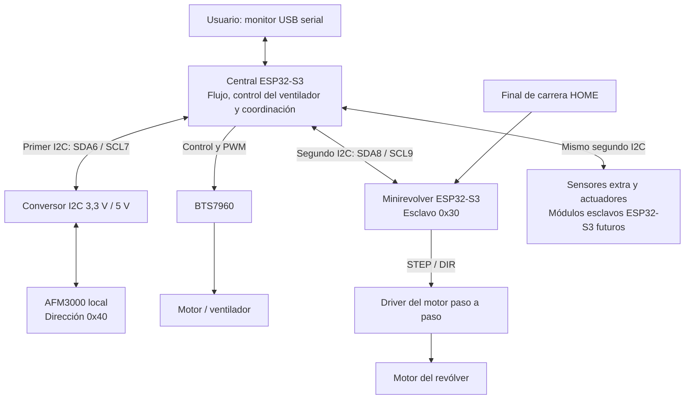
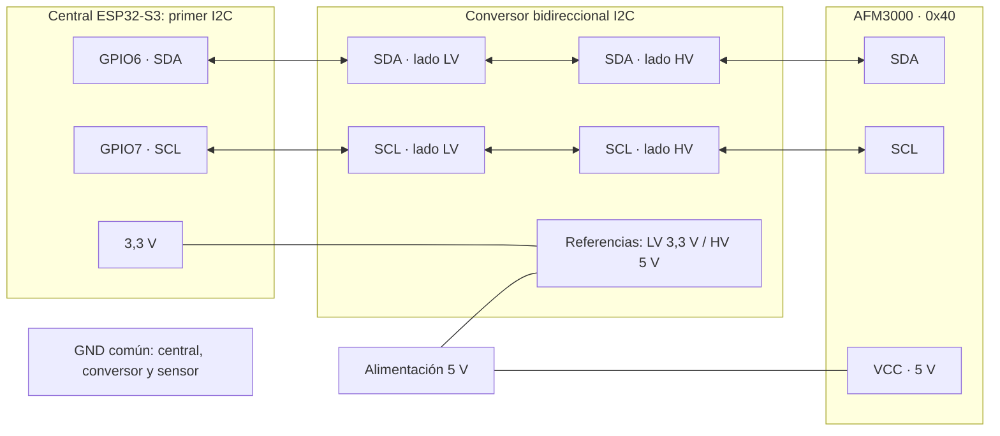
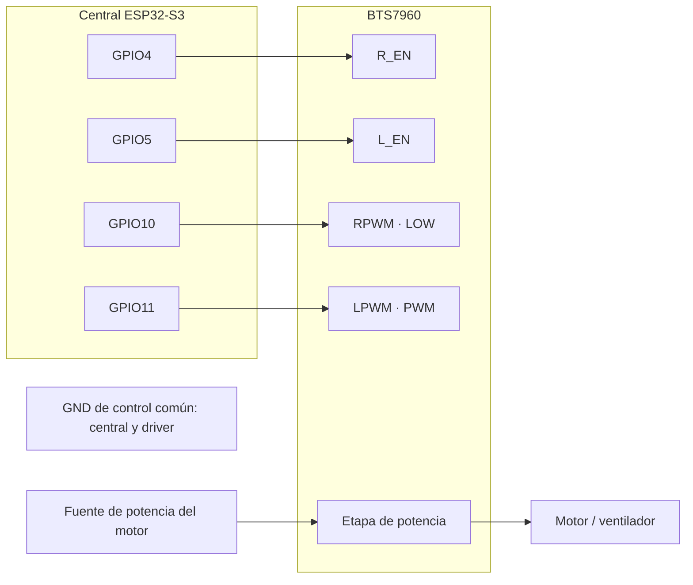
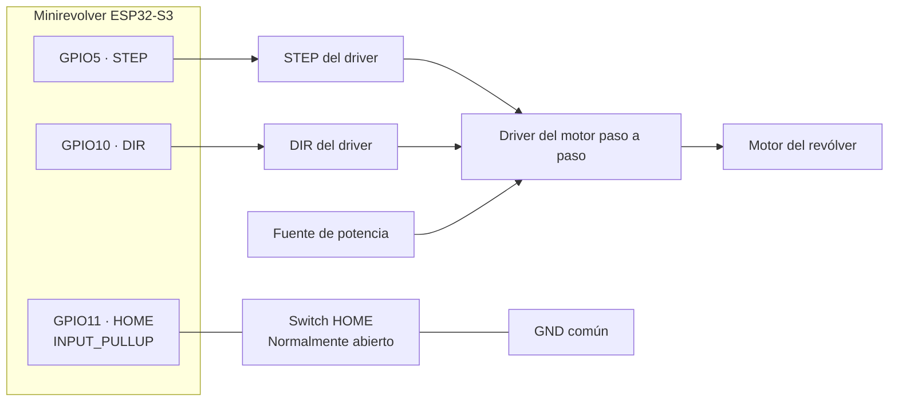
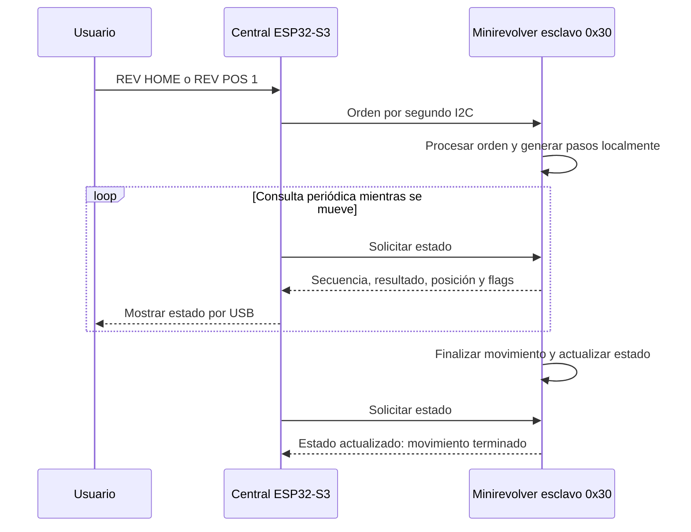

# Modular Air Flow

Sistema modular para **generar, medir y dirigir flujo de aire**, con **ESP32-S3 en la central y en todos los módulos adicionales**.

La central reúne el **sensor de flujo AFM3000**, el **control del motor/ventilador** y la interfaz de usuario. Todos los sensores extra y actuadores externos se incorporan como módulos esclavos al **segundo I2C**. El primer módulo conectado es el **minirevolver**, que controla localmente su motor paso a paso y su final de carrera.

## 1. Idea del sistema

La central mide el caudal, permite ajustar el PWM del ventilador y envía órdenes a los módulos. Cada módulo tiene su propio ESP32-S3, ejecuta su función y entrega su estado cuando la central lo consulta.

- **Central:** AFM3000, ventilador, interfaz de usuario y coordinación.
- **Minirevolver:** movimiento, búsqueda de origen y reporte de posición/estado.
- **Módulos adicionales:** sensores extra o actuadores con funciones y direcciones propias.

La interfaz actual es el monitor USB serial. Una pantalla, controles físicos o una interfaz web quedan por definir. El firmware actual permite ajustar el PWM manualmente y leer el flujo; el control automático de caudal todavía no está implementado.



El AFM3000 y el ventilador permanecen integrados en la central. El motor del revólver es un actuador distinto y lo controla el módulo minirevolver.

## 2. Los dos buses I2C

Esta es la asignación de pines del proyecto. El firmware configura los GPIO explícitamente; los pines predeterminados de la placa seleccionada en Arduino IDE pueden ser otros.

| Bus | Controlador | SDA | SCL | Uso |
| --- | --- | --- | --- | --- |
| Primer I2C | `TwoWire(0)` | **GPIO6** | **GPIO7** | AFM3000 y periféricos locales de la central |
| Segundo I2C | `TwoWire(1)` | **GPIO8** | **GPIO9** | Control y consulta de todos los módulos externos |

En ambos buses de la central, la central inicia las transacciones. En el segundo bus, los módulos trabajan como **esclavos**: reciben órdenes y responden a las consultas. Todos comparten las mismas líneas SDA, SCL y GND, con una dirección distinta por módulo.

El minirevolver usa también su segundo controlador, `TwoWire(1)`, con SDA8/SCL9 en modo esclavo. Su primer I2C queda reservado en GPIO6/7 y no se inicializa en el sketch actual.

**Los buses son independientes:** no unir SDA del primer bus con SDA del segundo ni sus líneas SCL. Las placas y periféricos comparten la referencia GND.

| Bus de la central | Dirección | Dispositivo | Estado |
| --- | --- | --- | --- |
| Primer I2C | `0x40` | AFM3000 local | Lectura implementada |
| Segundo I2C | `0x30` | Minirevolver ESP32-S3 | Órdenes y respuestas implementadas; pendiente de prueba en hardware |
| Segundo I2C | `0x31`, `0x32` | Posibles módulos futuros | Direcciones de ejemplo; firmware pendiente |

## 3. Conexiones de la central ESP32-S3

### Sensor de flujo AFM3000: primer I2C

El AFM3000 utiliza alimentación de **5 V**. SDA y SCL pasan por un **conversor bidireccional para I2C de 3,3 V a 5 V**, como en el montaje de flujo anterior.

| Central / alimentación | Conversor de nivel | AFM3000 |
| --- | --- | --- |
| GPIO6, SDA del primer I2C | SDA lado 3,3 V → SDA lado 5 V | SDA |
| GPIO7, SCL del primer I2C | SCL lado 3,3 V → SCL lado 5 V | SCL |
| 3,3 V | Referencia LV | — |
| 5 V | Referencia HV | VCC, 5 V |
| GND común | GND | GND |



Los nombres de los canales del conversor pueden variar según la placa. La tabla describe las señales; verificar el pinout del sensor y del conversor utilizados. Cada lado del conversor lleva sus pull-ups a su tensión correspondiente.

### Motor/ventilador local: BTS7960

| Central ESP32-S3 | Señal del BTS7960 | Función en el firmware |
| --- | --- | --- |
| GPIO4 | R_EN | Habilitación |
| GPIO5 | L_EN | Habilitación |
| GPIO10 | RPWM | Se mantiene en LOW |
| GPIO11 | LPWM | PWM manual, de 0 a 255 |
| GND | GND de control | Referencia común |



La tabla fija las señales de control. La alimentación lógica y de potencia del BTS7960 y las conexiones del motor se realizan según el módulo y motor utilizados. El motor recibe alimentación a través del driver.

**Cambio de cableado:** GPIO6/7 quedan reservados para el primer I2C. Las señales RPWM/LPWM que antes ocupaban esos pines pasan a GPIO10/11.

## 4. Conexión del minirevolver: segundo I2C

### Enlace entre la central y los módulos

| Señal | Central ESP32-S3 | Minirevolver ESP32-S3 |
| --- | --- | --- |
| SDA del segundo I2C | **GPIO8** | **GPIO8** |
| SCL del segundo I2C | **GPIO9** | **GPIO9** |
| Referencia | **GND** | **GND** |

Los siguientes módulos se conectan en paralelo a esas mismas señales. Cada módulo recibe su alimentación por una conexión definida aparte.

```text
Central ESP32-S3       Minirevolver S3       Módulo S3 extra
                      esclavo 0x30          dirección propia

GPIO8 · SDA ────────── GPIO8 · SDA ────────── GPIO8 · SDA

GPIO9 · SCL ────────── GPIO9 · SCL ────────── GPIO9 · SCL

GND ───────────────── GND ───────────────── GND

Pull-ups del bus: SDA → 3,3 V y SCL → 3,3 V.
```

El diagrama representa **tres redes separadas**: SDA, SCL y GND. Para evitar confusiones al cablear, seguir la tabla GPIO8↔GPIO8, GPIO9↔GPIO9 y GND↔GND.

El bus de módulos funciona a **100 kHz**, con señales de **3,3 V**. Para el montaje inicial, usar cables cortos y un par de pull-ups de **4,7 kΩ a 3,3 V** como punto de partida. Revisar las resistencias presentes en las placas: las pull-ups se combinan en paralelo.

Conector de señales propuesto: **1 GND, 2 SDA, 3 GND, 4 SCL**. La numeración es una propuesta del proyecto, no un pinout universal de conectores.

### Motor y final de carrera del minirevolver

| Minirevolver ESP32-S3 | Conexión | Función |
| --- | --- | --- |
| GPIO5 | STEP del driver | Pulsos del motor |
| GPIO10 | DIR del driver | Sentido de giro |
| GPIO11 | Contacto HOME | Final de carrera, `INPUT_PULLUP`, activo LOW |
| GND | Otro contacto del switch HOME | Contacto normalmente abierto hacia GND |
| GND | GND de control del driver | Referencia común |
| GPIO6 / GPIO7 | Primer I2C reservado | Sin inicializar en este sketch |



DIR y HOME pasan a GPIO10/11 para liberar GPIO6/7. Los GPIO pertenecen a cada placa: GPIO5 de la central y GPIO5 del revólver son señales independientes. El driver determina corriente y micropasos; el sketch no maneja un pin ENABLE.

La posición informada es un conteo de pasos enviados, sin encoder. El módulo arranca sin mover y exige completar la búsqueda de origen antes de aceptar posiciones absolutas. Los límites del ejemplo deben ajustarse a la mecánica.

## 5. Cómo se comunican

La central envía una orden a `0x30`. El minirevolver la procesa en su bucle, ejecuta el movimiento y publica una instantánea de estado. La central consulta periódicamente esa respuesta, incluso durante el movimiento.



Una orden recibida no significa que el movimiento haya terminado. La central muestra `moviendo`, `homing`, `origen` y `resultado`. El protocolo usa órdenes de **10 bytes** y respuestas de **14 bytes**, con secuencia y CRC8. La especificación está en [sistemasI2C/README.md](sistemasI2C/README.md#protocolo-versión-1).

Si no hay confirmación en 2 segundos, la central informa que la ejecución es incierta y no reenvía automáticamente la orden. Si se pierde el enlace, un movimiento ya aceptado continúa localmente hasta su destino o límite de búsqueda; no hay watchdog de comunicación.

## 6. Firmware y comandos

Cada carpeta con un `.ino` es un **sketch independiente**. Cargar en cada placa únicamente el sketch correspondiente, junto con sus headers.

| Placa | Sketch | Preparación |
| --- | --- | --- |
| Central ESP32-S3 | [centralI2C.ino](centralI2C/centralI2C.ino) | Arduino-ESP32 2.0.17, USB nativo y USB CDC On Boot activado |
| Minirevolver ESP32-S3 | [minirevolveri2c.ino](minirevolveri2c/minirevolveri2c.ino) | ESP_FlexyStepper; USB CDC On Boot para leer el diagnóstico por USB nativo |

Abrir el monitor de la central a **115200**, con terminación **Nueva línea** o **Ambos NL y CR**.

| Comando | Acción |
| --- | --- |
| `PWM 128` | Ajustar el PWM del ventilador local a 128/255; admite 0..255 |
| `STOP` | Apagar solamente el ventilador |
| `REV HOME` | Buscar el origen del revólver |
| `REV POS 1` | Solicitar destino absoluto de 150 pasos |
| `REV POS 2` | Solicitar destino absoluto de 350 pasos |
| `REV POS 3` | Solicitar destino absoluto de 550 pasos |
| `REV MOVE 160` | Solicitar destino absoluto de 160 pasos; admite 0..2000 |
| `REV STOP` | Pedir parada del revólver |
| `ESTADO` | Mostrar flujo, PWM y estado del revólver |
| `AYUDA` | Mostrar los comandos disponibles |

Las posiciones y el límite de 2000 pasos son provisionales. Esperar `origen: 1` después de `REV HOME` antes de solicitar posiciones. El ventilador arranca apagado y el revólver no se mueve al encender las placas.

## 7. Estado del proyecto y pruebas

La arquitectura central + minirevolver tiene firmware preparado, pero **está pendiente de compilación y prueba en hardware por el usuario**. El modelo concreto de placa S3 y los conectores todavía deben elegirse; comprobar que la placa exponga los GPIO asignados y que no estén ocupados por componentes propios.

Primera integración:

1. Revisar alimentación y cableado, incluidos los cambios de pines del motor.
2. Cargar los sketches correspondientes en la central y el minirevolver.
3. Consultar `ESTADO` y verificar la respuesta del módulo y el cambio del switch HOME al accionarlo.
4. Ejecutar `REV HOME` y comprobar el sentido físico de búsqueda y el límite mecánico.
5. Con `origen: 1`, probar una posición y consultar el estado durante el movimiento.
6. Probar `PWM n`, observar el flujo y usar `STOP` para apagar el ventilador.

Los módulos extra todavía requieren firmware propio y ampliar la central para consultar sus direcciones. Para extender el cableado, verificar capacitancia, flancos y ruido; RS-485 o CAN son alternativas futuras para enlaces de metros, sin implementación actual.

### Resultados anteriores del montaje de flujo

Estas observaciones corresponden al montaje probado anteriormente en ESP32-C3, según lo informado por el usuario. No constituyen una validación del nuevo firmware S3.

| Observación | Alcance |
| --- | --- |
| Flujo aproximado de 2 a 35 slm | Rango observado con ese ventilador y montaje |
| Puede no arrancar con PWM 160 y mantenerse a ese valor después de arrancar | Umbrales de arranque y marcha diferentes |
| Se detiene cerca de PWM 60 al reducir la orden | Valor aproximado observado; sin límite automático aplicado |
| Referencia de 1,8 slpm frente a lecturas AFM3000 de 1,90 a 2,30 slm | Diferencia pendiente de estudiar; sin corrección de calibración |

`slm` expresa litros estándar por minuto. El manual disponible del AFM3000 usa 20 °C y 1013 mbar. Confirmar las condiciones estándar al comparar con otro equipo. El sensor compensa internamente la temperatura; el manual disponible no documenta un comando para leerla.

El control automático de flujo, el impulso de arranque, un mínimo automático de marcha y una corrección de calibración quedan pendientes. Las ideas anteriores de PWM 255 durante 300 ms y mínimo 70 no están validadas ni implementadas.

## 8. Organización del repositorio

| Carpeta | Contenido |
| --- | --- |
| [centralI2C](centralI2C/README.md) | Central S3: flujo, PWM, dos buses y órdenes a módulos |
| [minirevolveri2c](minirevolveri2c/README.md) | Revólver S3 como esclavo en el segundo I2C |
| [sistemasI2C](sistemasI2C/README.md) | Detalles del enlace, cableado y protocolo versión 1 |
| [ventiladorFlujo](ventiladorFlujo/README.md) | Prueba anterior de PWM y AFM3000 en ESP32-C3, funcionamiento confirmado |
| [airSensor](airSensor/README.md) | Prueba aislada del sensor y manual PDF, lecturas confirmadas |
| [pruebaPWM](pruebaPWM/README.md) | Prueba anterior de analogWrite en GPIO9 de ESP32-C3 |
| [ventilador](ventilador/README.md) | Prueba anterior de rampas del puente en ambos sentidos |
| [minirevolver](minirevolver/README.md) | Control original por serial; pines anteriores 5/23/27 |

Los sketches anteriores se conservan como referencias funcionales. Sus pines y placas corresponden a esos montajes; seguir las tablas de este README para la arquitectura nueva.

## 9. Reglas de trabajo

Por indicación del usuario, el asistente **no debe compilar ni cargar firmware**. Las verificaciones del asistente son revisiones de código, documentación y archivos; las pruebas físicas confirmadas son las comunicadas por el usuario.

Guardar sketches y headers como UTF-8 **sin BOM**. Mantener idénticas las copias de `Protocolo.h` de central y minirevolver. Conservar las pruebas funcionales anteriores al desarrollar nuevas versiones.
