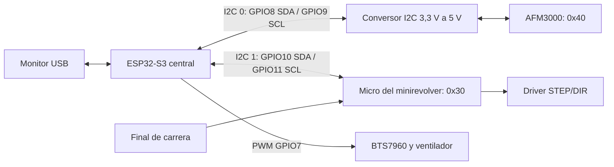

# Propuesta modular: central y minirevolver

Ejemplos nuevos para probar una arquitectura modular. No sustituyen los sketches que ya funcionan. **No compilados ni probados físicamente por el asistente.** El usuario compila, carga y verifica el hardware.

## Elección del enlace

| Enlace | Uso propuesto |
| --- | --- |
| I2C | Sensores y módulos próximos, con cables cortos y direcciones distintas |
| UART lógico TX/RX | Enlace directo entre dos equipos; no unir varias salidas TX sin una solución de arbitraje |
| RS-485 sobre UART | Varios módulos sobre un par diferencial compartido, especialmente si salen de la caja y necesitan cables más largos |
| CAN/TWAI con transceptores | Red de módulos con arbitraje y mensajes; alternativa para ampliar el sistema |

I2C ya es una comunicación serial y bidireccional. Un bus admite varios dispositivos en paralelo; no hace falta un bus por módulo. El central inicia las transacciones: escribe órdenes y consulta las respuestas. El módulo no envía datos espontáneamente; una línea adicional de interrupción sería una ampliación opcional.

El ESP32-S3 tiene dos controladores I2C. Aquí se separan sensores y módulos para tener dos buses físicos independientes. El ESP32-C3 puede funcionar como módulo con un solo bus. Otro central con dos controladores también es posible, pero el sketch entregado para el central exige S3.

## Distribución

Los números 0 y 1 son los controladores del **central**. El minirevolver usa su propio `Wire` como dispositivo: su controlador local puede ser el número 0 aunque esté conectado al bus 1 del central. No se unen SDA0 con SDA1 ni SCL0 con SCL1; solo se comparte GND.

- [centralI2C](../centralI2C/README.md): central S3, sensor, PWM y órdenes remotas.
- [minirevolveri2c](../minirevolveri2c/README.md): módulo con motor y final de carrera.
- Los archivos `Protocolo.h` de ambas carpetas deben mantenerse idénticos.

## Cableado corto y módulos fuera de la caja

Propuesta de conector de señales del bus de módulos: **1 GND, 2 SDA, 3 GND, 4 SCL**. Señales de 3,3 V. Alimentar cada módulo por una conexión de alimentación definida aparte; no alimentar el motor desde las señales I2C ni unir sin criterio las salidas de reguladores de distintas placas. Conectar con la alimentación apagada; este ejemplo no implementa conexión en caliente.

Comenzar con cables de unas pocas decenas de centímetros, bus a 100 kHz y un par de pull-ups de 4,7 kΩ a 3,3 V como punto de partida del bus de módulos. Revisar las resistencias ya presentes: varias placas con pull-ups en paralelo reducen la resistencia efectiva. La distancia admisible depende de la capacitancia, las resistencias y el ruido; la longitud propuesta no es una garantía. Separar señales de cables del motor y comprobar los flancos si se amplía el cableado.

El bus del AFM3000 requiere conversor bidireccional y alimentación de 5 V del sensor, como el montaje anterior. Los pull-ups del lado de los ESP32 deben ir a 3,3 V. Cada bus tiene sus propios pull-ups.

Para módulos que salgan del equipo con cables de metros, la propuesta es conservar las órdenes y la ejecución local del motor y migrar el transporte a RS-485 o CAN. El código entregado aquí implementa **solo I2C**.

## Direcciones y crecimiento

| Bus del central | Dirección | Equipo |
| --- | --- | --- |
| I2C 0 | `0x40` | AFM3000 |
| I2C 1 | `0x30` | Minirevolver |
| I2C 1 | `0x31`, `0x32` | Ejemplos de direcciones disponibles para futuros módulos, no implementados |

Para varios módulos, asignar una dirección única por bus y ampliar el central para seleccionar y consultar cada uno. Este central controla un minirevolver. Si se necesitan varios AFM3000 con dirección fija, usar un multiplexor I2C o buses separados; no conectarlos todos con la misma dirección al mismo bus.

## Protocolo versión 1

Orden de 10 bytes, enviada a `0x30`:

| Byte | Contenido |
| --- | --- |
| 0 | `0xA5` |
| 1 | Versión `1` |
| 2 | Operación: 1 mover, 2 home, 3 parar |
| 3 | Secuencia de 8 bits, incrementada por el central |
| 4..7 | Argumento int32 en complemento a dos, byte menos significativo primero; destino en pasos |
| 8 | Reservado, cero |
| 9 | CRC8 de bytes 0..8 |

Respuesta de 14 bytes, consultada aproximadamente cada 100 ms:

| Byte | Contenido |
| --- | --- |
| 0 | `0x5A` |
| 1 | Versión `1` |
| 2 | Flags: bit 0 moviendo, bit 1 homing, bit 2 origen establecido, bit 3 switch activo |
| 3 | Resultado de la última orden procesada o fallo posterior de homing |
| 4 | Secuencia de la última orden procesada |
| 5..8 | Posición estimada int32, byte menos significativo primero |
| 9..12 | Destino int32, byte menos significativo primero |
| 13 | CRC8 de bytes 0..12 |

CRC8 inicial cero, polinomio 0x31, sin reflexión ni XOR final. Se serializan bytes explícitamente, sin depender del relleno de estructuras C++.

Resultados: **0 OK**, **1 ocupado**, **2 fuera de rango**, **3 sin origen**, **4 home no encontrado**, **5 operación inválida**, **6 trama inválida**. El ACK eléctrico I2C confirma recepción del transporte, no ejecución. La secuencia devuelta confirma que el programa del módulo procesó la orden; `resultado=0` y `moviendo=0` permiten observar su finalización, considerando el estado de homing.

El central permite una orden pendiente de confirmación; `REV STOP` puede reemplazarla. Tras 2 segundos sin confirmación informa estado incierto y no reenvía automáticamente. El módulo no elimina duplicados: repetir HOME puede repetir el movimiento. Un reinicio pierde origen y estado de comandos; revisar el estado antes de continuar. En el ESP32 clásico una respuesta puede estar precargada desde la consulta anterior; por eso se consulta periódicamente y no se presupone respuesta inmediata a una escritura.

## Fuentes de diseño

- [I2C del ESP32-S3: dos controladores](https://docs.espressif.com/projects/esp-idf/en/latest/esp32s3/api-reference/peripherals/i2c.html).
- [API Wire de Arduino-ESP32](https://docs.espressif.com/projects/arduino-esp32/en/latest/api/i2c.html) y [ejemplo de dispositivo del core 2.0.17](https://github.com/espressif/arduino-esp32/blob/2.0.17/libraries/Wire/examples/WireSlave/WireSlave.ino).
- [ESP-FlexyStepper y movimiento no bloqueante](https://github.com/pkerspe/ESP-FlexyStepper).
- [TI: capacitancia del bus I2C](https://www.ti.com/product/P82B715) y [RS-485 multipunto](https://www.ti.com/document-viewer/lit/html/SSZT500/GUID-01F0FE11-3C17-49A5-9444-4BF74E5E0488).
